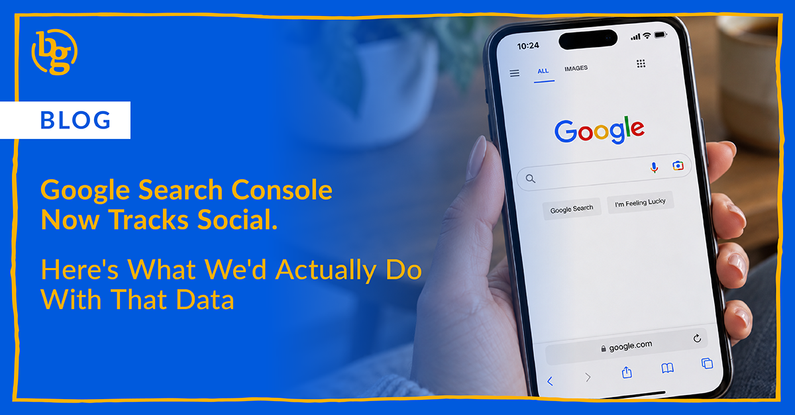

Google added platform properties to Search Console, which means social teams can finally see the exact search queries sending people to their Instagram, TikTok, X, and YouTube posts. We break down what the data covers, what it leaves out, and how we'd use it for client reporting. We also tackle the big question for B2B brands: what to do while LinkedIn isn't on the supported list.

Google just gave social media teams something we've wanted for a long time: a look at how our posts show up in Google. In July, Search Console added platform properties, which let you connect Instagram, TikTok, X, and YouTube accounts and see the exact search terms leading people to your posts. It even works for accounts with no website behind them.

If you've ever told a client their Instagram post is showing up when people search a topic, and had nothing to show them, this one's for you. Here's what the data covers, what it doesn't, and how we'd work it into client reporting.

## What Google Actually Added

Google announced platform properties on July 7 and [rolled them out globally](https://developers.google.com/search/blog/2026/07/platform-properties-social-video-guide). Once an account is connected, you get a Performance report with clicks, impressions, click-through rate, and average position, filterable by post and by query. There's also an Insights report that surfaces top posts, and an Achievements report that tracks milestones like hitting a new click threshold.

One thing to know up front. Per [Google's own help page](https://support.google.com/webmasters/answer/17148418), "platform properties only show how your content performs on Google Search. They don't track when people see your content on the platform itself." So this is a Google visibility tool, not a replacement for your native analytics.

## What the Query Data Actually Tells Us

This is the part we're most interested in. Likes and comments tell you how people reacted to a post. Search queries tell you what people were looking for when they found it. That's a different kind of signal, and it's one social teams haven't had before.

A few things we'd look for. First, queries you never planned for. If a post is pulling in searches on a topic you only mentioned in passing, that's a free content idea. Second, gaps between your wording and theirs. If your captions say "workflow automation" but people are searching "how to stop entering data by hand," you've learned how your audience actually talks. Third, older posts that keep showing up. Search traffic doesn't expire the way feed reach does, which is one more reason to [get more mileage out of the content you've already made](https://brandglue.com/blog/social-media-mileage-b2b-content/).

**The BG take:** Treat it as research first. Use the queries to shape captions, on-screen text, and video titles. Just don't expect it to move your website rankings. Platform properties are a measurement tool, not a way to index your site, and writing for these queries isn't a guaranteed ranking lever. We'll know more as people run it for a few months.

## What It Doesn't Tell Us

No likes, shares, comments, or watch time. Those stay inside each platform. Numbers also may not line up with native analytics, since some video clicks [open in Google's viewer instead of the app](https://www.iconosquare.com/blog/google-search-console-social-media). And data starts when you connect, with no backfill, so every week you wait is a week of queries you don't get to see.

## What This Means for Agencies

Here's where it gets practical. Each social account is its own property, and from what we can tell there's [no bulk setup or API](https://www.digitalapplied.com/blog/search-console-platform-properties-social-video-seo-2026) yet. If you manage a dozen client profiles, that's a dozen manual connections, and each one needs someone with the account login to authorize it. Google also says ownership is periodically re-checked, so connections can expire and need re-verifying.

**The BG take:** Our plan is simple. Add platform property setup to client onboarding, put a quarterly reminder on the calendar to check that connections are still live, and add a "Google visibility" section to monthly reports, clearly labeled and kept separate from native engagement numbers. And set expectations early: this shows how posts perform in Google, not how the client's website ranks.

## The LinkedIn Question

Here's the catch for B2B. LinkedIn isn't on the supported list. It's Instagram, TikTok, X, and YouTube only, and [LinkedIn has no platform property yet](https://www.searcle.ai/insights/search-console-platform-properties-linkedin-not-supported), so no query data, clicks, or impressions for company pages or posts. For a lot of our clients, LinkedIn is where the work happens, so that's a real gap.

Until that changes, we'd combine what we do have: native LinkedIn analytics, tagged referral traffic in web analytics, Search Console data for the client's website, and branded query trends. Just don't present that mix as direct LinkedIn search data, because it isn't. It also fits with how we're already thinking about [social content and AI search](https://brandglue.com/blog/linkedin-reddit-ai-search/): more of what you post is getting found outside the feed, and measurement is slowly catching up.

**The BG take:** For B2B, YouTube is the sleeper here. Demos, webinars, and podcast clips are exactly what people search for when they're researching a purchase. If a client has a YouTube channel, connect it first. We'll update this post if LinkedIn gets added.

Not sure which of your profiles to connect first, or how to fold this into your reporting? That's the kind of thing we like to sort out. Reach out, or [see what working with us actually looks like](https://brandglue.com/blog/partner-b2b-social-first-agency/) first.

***And tell us: have you connected your accounts yet? What queries surprised you?***